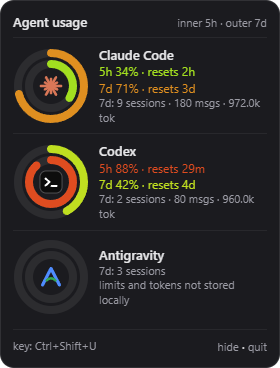

# agent-usage-hud

A small always-on-top overlay for **Windows and macOS** that shows how much of your AI coding agent limits you have used. Press a hotkey, it slides in on the right edge of your screen; press it again and it's gone.



- **Inner ring:** current 5-hour session limit
- **Outer ring:** weekly (7-day) limit
- Rings go from **green to red** as you approach the limit, and animate every time you open the overlay
- Every agent you used this week is stacked on top of each other; the more agents, the smaller the rings
- Below each ring: sessions, messages and tokens over the last 7 days

Supported agents:

| Agent | Session (5h) & weekly limit | Sessions / messages / tokens (7 days) |
|---|---|---|
| Claude Code | ✅ via the status line script (one-time setup, see below) | ✅ from `~/.claude/projects` |
| Codex CLI | ✅ from its own logs | ✅ from `~/.codex/sessions` |
| Cursor | ❌ not stored on your machine | sessions + messages from Cursor's local database (tokens usually not stored) |
| Antigravity | ❌ not stored on your machine | sessions only (conversation files are not readable) |

If an agent doesn't store a number locally, the overlay says so instead of guessing.

## Install

You need [Node.js](https://nodejs.org) 18 or newer.

```bash
git clone https://github.com/meteserpil/agent-usage-hud.git
```

```bash
cd agent-usage-hud
```

```bash
npm install
```

```bash
npm start
```

The overlay shows once at start so you can see it works, then lives in the background.

## Use it

- **Toggle:** `Ctrl+Shift+U` on Windows, `Cmd+Shift+U` on macOS
- **Change the key:** click `key: …` at the bottom of the overlay and press the combination you want (for example `Ctrl+Alt+K` or just `F9`). It needs a modifier key unless it's an F-key, so it can't swallow normal typing. Your choice is saved.
- **hide** hides it, **quit** closes the app.

The overlay doesn't steal focus, so you can keep typing in your editor while it's open.

## Claude Code limits (one-time setup)

Claude Code only shares your 5-hour and weekly limit with its [status line](https://code.claude.com/docs/en/statusline). This repo ships a tiny status line script that saves those two percentages for the overlay and prints them at the bottom of Claude Code:

```
5h 34% · 7d 71%
```

Add this to `~/.claude/settings.json` (use the real path to where you cloned the repo):

```json
{
  "statusLine": {
    "type": "command",
    "command": "node /path/to/agent-usage-hud/claude-statusline.js"
  }
}
```

On Windows, use forward slashes, for example `node C:/Users/you/agent-usage-hud/claude-statusline.js`.

Notes:
- This replaces any status line you already have.
- Limits are only available on Claude Pro and Max plans, and appear after the first reply in a session.
- The percentages update whenever Claude Code refreshes its status line, so start a Claude Code session to see fresh numbers.

## Is it safe?

This app was written to be easy to audit. It's a few hundred lines of plain JavaScript with no runtime dependencies (only Electron itself).

- **Read-only.** It only reads the agents' log files. Cursor's database is opened in read-only mode. It never changes, moves or deletes anything those tools own.
- **Offline.** It makes no network requests: no telemetry, no analytics, no update checks, no accounts, no API keys.
- **Nothing sensitive leaves the log files.** Only numbers (counts, token totals, percentages) are passed to the window. Your prompts and code are never displayed or stored.
- **It writes only two small files:**
  - `~/.agent-usage-hud/claude-limits.json`: the two Claude limit percentages and their reset times (written by the status line script)
  - `config.json` in the app's data folder: your hotkey
- **No keylogging.** The hotkey uses the operating system's global shortcut API (the same one media keys use). It only learns when *your* chosen combination is pressed. On macOS it needs no Accessibility or Input Monitoring permission.
- **Locked-down window.** Sandboxed renderer, context isolation, no Node in the page, a strict Content Security Policy, navigation and pop-ups blocked, and all permission requests (camera, mic, etc.) denied.

Don't take my word for it: the whole app is [`usage.js`](usage.js) (reading the logs), [`main.js`](main.js) (window and hotkey), [`renderer.js`](renderer.js) (drawing) and [`claude-statusline.js`](claude-statusline.js).

## Where the data comes from

| Agent | Path |
|---|---|
| Claude Code | `~/.claude/projects/**/*.jsonl` (or `$CLAUDE_CONFIG_DIR/projects`) |
| Codex | `~/.codex/sessions/**/*.jsonl` (or `$CODEX_HOME/sessions`) |
| Cursor | Windows `%APPDATA%\Cursor\User\globalStorage\state.vscdb`, macOS `~/Library/Application Support/Cursor/User/globalStorage/state.vscdb` |
| Antigravity | `~/.gemini/antigravity/conversations/*.pb` |

"Last 7 days" is a rolling window. Claude Code tokens are input + cache writes + output; cache reads are left out of the token count because they would dwarf everything else.

## Tests

```bash
npm test
```

The tests use made-up log folders, never your real data. They need Node.js 22 or newer (for the built-in SQLite module).

## Limitations

- Not tested on Linux, but it should work there.
- These agents' log formats aren't official APIs, so an agent update can break a reader. If a number looks wrong, open an issue.
- The logos are simplified marks drawn in SVG. The names and trademarks belong to their owners; this project isn't affiliated with Anthropic, OpenAI, Anysphere or Google.

## License

MIT
